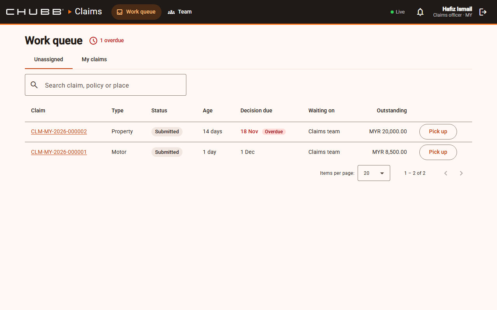
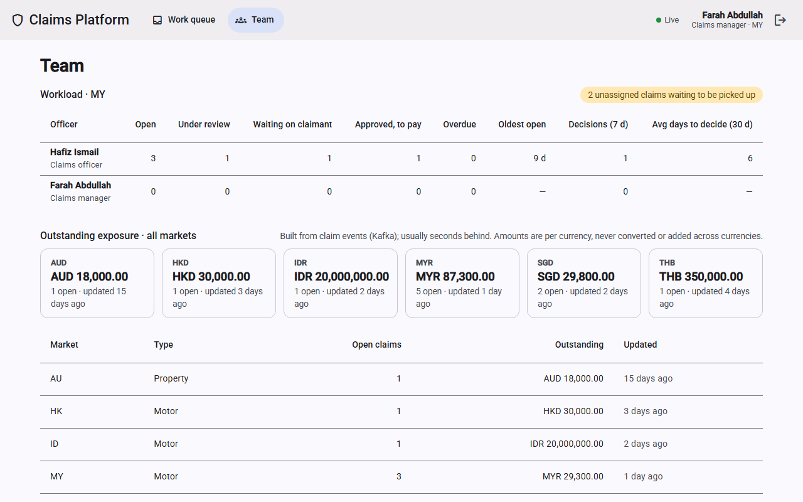
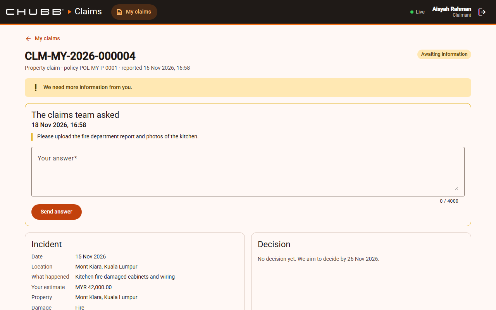
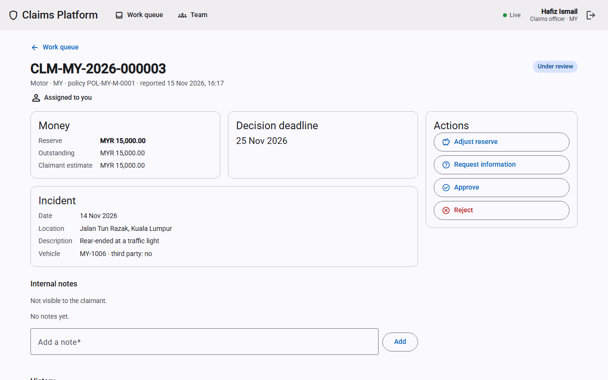
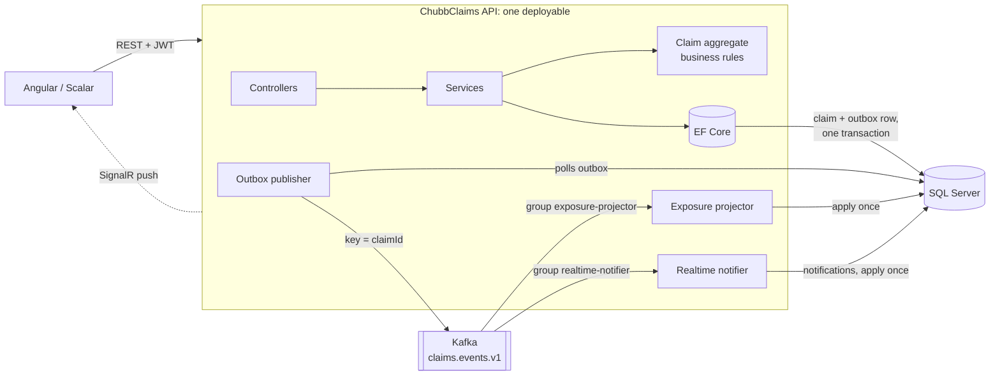

# ChubbClaims: Claims Platform (Chubb APAC take-home)

Motor and property claims across six APAC markets (MY, SG, HK, TH, ID, AU).

- **Claimants** report an incident (first notice of loss, FNOL), track their claim, answer questions and receive the decision.
- **Claims officers** pick up claims in their market, set the reserve, ask for information, approve and settle, or reject.
- **Managers** see team workload and a near-real-time view of outstanding liability exposure.

**Status:** complete. The backend has every P0 and P1 item. The Angular frontend covers both user types end to end, with live updates (all its P0 and P1 items).

| Officer's work queue | Manager's team view: workload and live exposure |
|---|---|
|  |  |
| **Claimant: the claims team asked a question** | **Officer's claim workbench** |
|  |  |

| Document | What it covers |
|---|---|
| [docs/architecture.md](docs/architecture.md) | Components, event flow, claim lifecycle, data model (diagrams) |
| [docs/decisions.md](docs/decisions.md) | Key decisions, the alternatives and when I would revisit them |
| [ChubbClaims_BE/BACKEND.md](ChubbClaims_BE/BACKEND.md) | The build spec the backend was built from, updated as decisions changed |
| [ChubbClaims_FE/README.md](ChubbClaims_FE/README.md) | The web app: screens, how one codebase serves both user types, frontend decisions |
| [ChubbClaims_FE/FRONTEND.md](ChubbClaims_FE/FRONTEND.md) | The build spec the frontend was built from |
| [AI_JOURNAL.md](AI_JOURNAL.md) | How I worked with AI: what I asked for, accepted, challenged and overrode, per phase |

---

## Run it

Prerequisites: **Docker Desktop** for the backend, and **Node 22.22+ or 24.15+** for the web app.

```bash
git clone https://github.com/aslam6161/ChubbClaims.git
cd ChubbClaims
cp .env.example .env        # SQL Server sa password; change it if you like
docker compose up --build   # first run: ~2-3 min (image pulls and build)
```

The API waits for SQL Server, applies migrations, seeds demo data and starts publishing events to Kafka.

Then, in a second terminal, start the web app:

```bash
cd ChubbClaims_FE
npm ci
npm start                   # http://localhost:4200
```

Open http://localhost:4200 and pick a demo user. The dev server proxies the API and the SignalR hub, so nothing else needs configuring.

| What | URL |
|---|---|
| Web app (after `npm start`) | http://localhost:4200 |
| API reference (Scalar) | http://localhost:5080/scalar |
| OpenAPI document | http://localhost:5080/openapi/v1.json |
| Health | http://localhost:5080/health |
| Kafka UI (topic `claims.events.v1`) | http://localhost:8085 |
| SQL Server | `localhost,1433`, user `sa`, password from `.env` |

### Sign in (development login)

There is no identity provider (out of scope). `POST /api/auth/dev-login` with a seeded email returns a JWT.
In the web app, pick a user on the sign-in page. In Scalar: call **dev-login**, copy `accessToken`, click **Authorize** and paste it.

| Email | Role | Market |
|---|---|---|
| `claimant.my@demo.local` | Claimant | (policies in MY, incl. one expired) |
| `claimant.sg@demo.local` | Claimant | (policies in SG) |
| `officer.my@demo.local` | Claims officer | MY |
| `officer.sg@demo.local` | Claims officer | SG |
| `manager.my@demo.local` | Claims manager | MY (exposure covers all markets) |

There is also one claimant each in HK, TH, ID and AU (`claimant.hk@demo.local` and so on).
Seed data: 13 claims across all six markets and every status, including overdue claims and one waiting on the claimant.
Only MY and SG have staff, so the HK, TH, ID and AU claims stay unassigned. They are there so exposure covers six currencies.

### A five-minute tour in the browser

Open two browser windows side by side. Each tab keeps its own sign-in, so they can be different users.

1. **Claimant** (Aisyah Rahman), window 1: **My claims** says in plain words what happens next. `CLM-MY-2026-000004` has a question from the claims team to answer. Leave `CLM-MY-2026-000003` open.
2. **Officer** (Hafiz Ismail), window 2: the work queue shows unassigned MY claims in SLA order, with one overdue. Open **My claims** → `CLM-MY-2026-000003` → **Approve** with a settlement amount.
   Window 1 switches to **Approved** by itself about a second later.
3. **Claimant**: **Report an incident** on `POL-MY-M-0001`. It appears in the officer's unassigned queue without a refresh.
4. **Manager** (Farah Abdullah): **Team** shows workload and outstanding exposure per currency. The exposure updates within a second or two of each claim event, via Kafka.

### The same tour against the API

1. **Claimant** (`claimant.my`): `GET /api/policies/mine` → `POST /api/claims` on `POL-MY-M-0001` → 201 with a claim number.
   Try `POL-MY-M-0000` (expired, 422) or `POL-SG-M-0001` (someone else's, 404).
2. **Officer** (`officer.my`): `GET /api/work-queue` (unassigned, SLA order) → `POST /api/claims/{id}/pick-up` → `PUT …/reserve` → `POST …/approve` → `POST …/settle`.
3. **Manager** (`manager.my`): `GET /api/reports/exposure`. The new claim appears about a second after the FNOL, via Kafka. Also try `GET /api/team/workload`.
4. **Kafka UI**: open `claims.events.v1` to see each event, its `claimId` key and its `correlation-id` header.

### Run the API outside Docker (Visual Studio / CLI)

```bash
docker compose up -d sqlserver kafka kafka-ui
cd ChubbClaims_BE
dotnet run --project ChubbClaims.Presentation   # http://localhost:5080/scalar, connects to Kafka on localhost:9092
dotnet test ChubbClaims.slnx                    # unit tests; the smoke tests too once the API is up
```

Stop the `api` container first (`docker compose stop api`), since both use port 5080.

---

## Tests

| Suite | How | Count |
|---|---|---|
| Backend unit tests (xUnit, Shouldly, NSubstitute) | `dotnet test ChubbClaims_BE/ChubbClaims.Tests` | 284 |
| Frontend unit tests (Vitest) | `cd ChubbClaims_FE && npm test` | 99 |
| End-to-end smoke tests (xUnit) against the running stack: real SQL Server, Kafka and SignalR, any state | `dotnet test ChubbClaims_BE/ChubbClaims.SmokeTests` ([how](ChubbClaims_BE/ChubbClaims.SmokeTests/README.md)) | 46 tests, 105 checks |

`dotnet test ChubbClaims_BE/ChubbClaims.slnx` runs both backend suites. Without the stack running, the smoke tests show as skipped, not failed.

Unit tests cover the claim state machine and every business rule, plus:
- service orchestration and visibility
- the Kafka event contract, checked from both sides without a broker
- the exposure and notification rules
- the outbox publisher's ordering

The smoke tests also cover things unit tests can't:
- **10 simultaneous pick-ups of the same claim:** each time exactly one 204 and one 409, caught by the RowVersion check
- **Through Kafka:** exposure and notifications update shortly after the request that caused them
- **Push isolation:** another market's officer and another claimant receive nothing
- **Uploads:** an `.exe` renamed `photo.jpg` and an SVG are refused, an 11 MB upload gets a 413 before its body is read, and another claimant or market gets 404 for a file

Checked by hand against the stack (steps in the [journal](AI_JOURNAL.md)):
- **Replaying the whole topic** (consumer offsets reset to 0): every event is skipped as a duplicate and exposure is unchanged
- **Stopping Kafka:** claims are still accepted, and events drain from the outbox when Kafka returns

Frontend tests cover the guards, interceptors, the allowed-action table, FNOL validation (including the reporting deadline), realtime reload and polling, search and paging (including keeping the current page on screen while the next loads), toasts, the notification bell, and component tests for the claimant list, the work queue (including a 409) and the Team page.
Each web phase was also checked in a real browser against the running stack: both user types end to end, a decision in one browser updating another, and every screen at phone width.

---

## Architecture in one picture



- **Commands and queries go over REST; facts go over Kafka.** The user waits only for what can be rejected (FNOL validation, a 409). Exposure and notifications react to events afterwards.
- **One deployable (a modular monolith), with seams at Kafka.** The projector and notifier only consume events, so they can move to their own services without touching the claims write side.
- **The transactional outbox avoids dual writes.** A claim change and its event commit together. Publishing is at least once; consumers apply each event exactly once.

More detail, including the sequence and state diagrams: [docs/architecture.md](docs/architecture.md).

---

## What's built, and what I cut

| Priority | Item | Status |
|---|---|---|
| P0 | Claim aggregate, lifecycle state machine and business rules, with unit tests | ✅ |
| P0 | SQL Server + EF Core 10, migrations, seed data across six markets | ✅ |
| P0 | Claimant and officer REST endpoints | ✅ |
| P0 | Dev JWT, with role-based and resource-based authorization | ✅ |
| P0 | Transactional outbox → Kafka; idempotent exposure projection | ✅ |
| P0 | Scalar, Serilog (correlation id end to end), ProblemDetails | ✅ |
| P0 | `docker compose up` for the whole stack | ✅ |
| P1 | Realtime notifier → SignalR and in-app notifications | ✅ |
| P1 | Team workload and performance endpoint | ✅ |
| P1 | `/health` (database) | ✅ |
| P2 | Approval authority limit (manager must approve above a threshold) | ✂️ cut |
| P2 | Integration tests with WebApplicationFactory + Testcontainers | ✂️ cut (end-to-end smoke tests against the running stack instead) |
| P2 | Dead-letter topic for poison messages | ✂️ cut (invalid messages are logged and skipped; handler failures retry) |
| Web P0 | Dev sign-in, interceptors, role-guarded lazy areas, a home per role | ✅ |
| Web P0 | Claimant: report an incident (FNOL), my claims, claim detail, answer an information request | ✅ |
| Web P0 | Officer: work queue (overdue, 409 on pick-up), claim workbench with every action | ✅ |
| Web P0 | Loading, empty and error states; ProblemDetails shown in plain words; unit tests | ✅ |
| Web P1 | SignalR live updates with a polling fallback; Team page (workload, manager exposure) | ✅ |
| Web P1 | Server-side search and pagination on My claims and the work queue | ✅ |
| Web P2 | Committed Playwright end-to-end suite | ✂️ cut (browser checks were run per phase but not committed) |
| Web P2 | nginx container for the web app in docker compose | ✂️ cut (`npm start` runs it) |
| Web P2 | Notification bell with a chime; officers notified of new claims in their market | ✅ |
| Extra | Photos and documents on a claim (claimant and staff): private storage, type checked from the bytes, live updates and notifications | ✅ (Cloudinary adapter built; verified with the local-disk fallback only) |

**Out of scope by design:** real identity provider, virus scanning of uploads, payments integration, fraud scoring, real policy-admin integration (policies are seeded), FX conversion (exposure is reported per currency), email and SMS, multiple languages, per-market regulatory rules, layouts designed for mobile (the web app is responsive, not mobile-first), offline support.

**Known limitations I would fix next:**
- Paging for notifications (the bell shows the latest 50).
- The SLA clock keeps running while the claim waits on the claimant.
- A SignalR backplane (Redis) and outbox row locking, both needed before running more than one API instance.
- A job to rebuild the read models.

All of these are in [docs/decisions.md](docs/decisions.md).

---

## Repository layout

```
docker-compose.yml           SQL Server 2022, Kafka (KRaft), Kafka UI, API
docs/                        architecture.md, decisions.md
ChubbClaims_BE/
  ChubbClaims.Presentation   host: controllers, auth, SignalR hub, middleware, OpenAPI/Scalar
  ChubbClaims.Service        use cases, DTOs, mapping (no EF, no Kafka)
  ChubbClaims.Domain         claim aggregate, state machine, rules, events (no package references)
  ChubbClaims.Repository     EF Core, migrations, seed, transactional outbox
  ChubbClaims.Messaging      outbox publisher, Kafka consumers, event contract
  ChubbClaims.Tests          unit tests
  ChubbClaims.SmokeTests     end-to-end tests against the running stack (HTTP and SignalR, black-box)
ChubbClaims_FE/              Angular 22 web app for claimants and claims staff (see its README)
docs/screenshots/            the screenshots above
```

## Time and AI use

The backend was built in about 1 h 45 min of implementation, from the first code commit (10:15) to the last backend merge (11:55). The specs were planned before that.
The frontend followed in six phases of its own, each reviewed and merged in the same way.
Development used Claude Code throughout. [AI_JOURNAL.md](AI_JOURNAL.md) records each phase: what I asked for, what I accepted, and where I challenged or overrode the AI. Examples include the read-modify-write race in the exposure projector, a nullable enum that leaked into the OpenAPI contract, and "overdue" flagging claims that were already decided.
Every phase was built on its own branch, reviewed, and merged with `--no-ff`, so `git log --graph` shows the steps.
