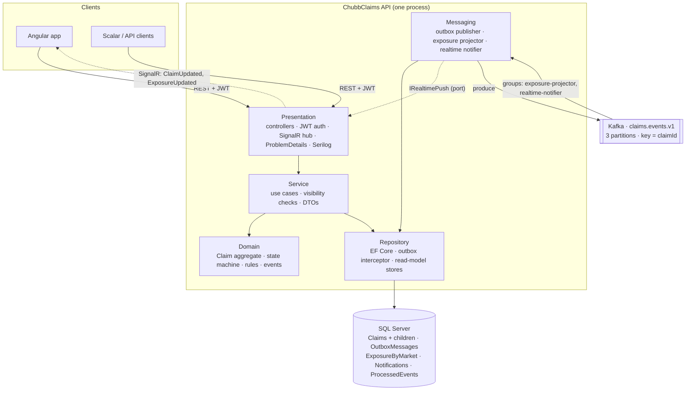
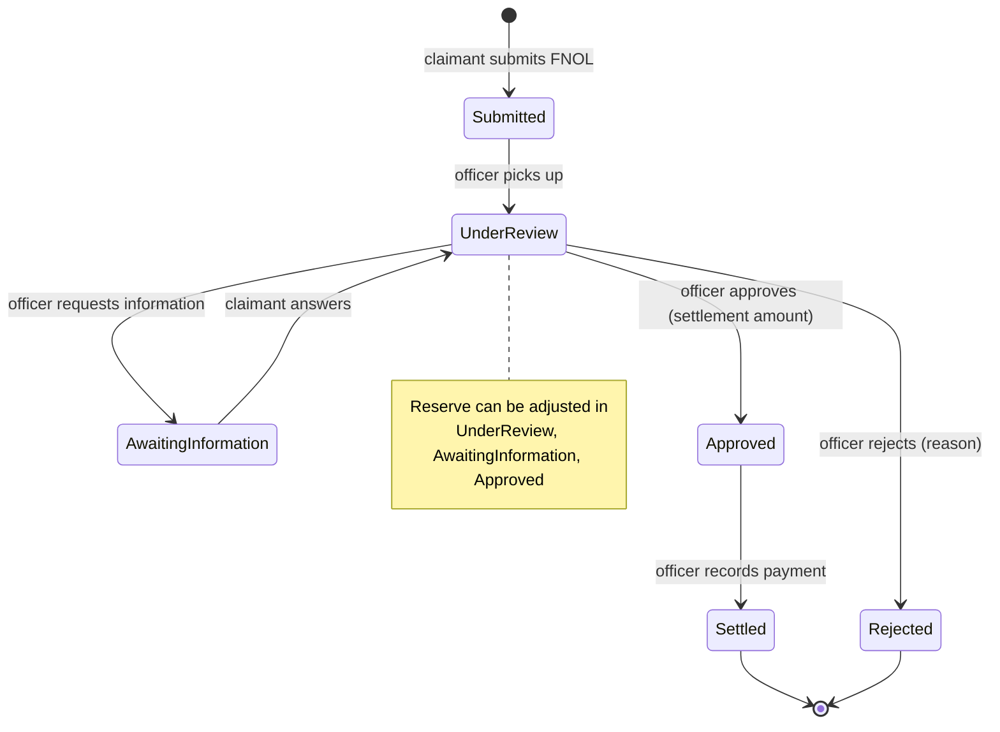
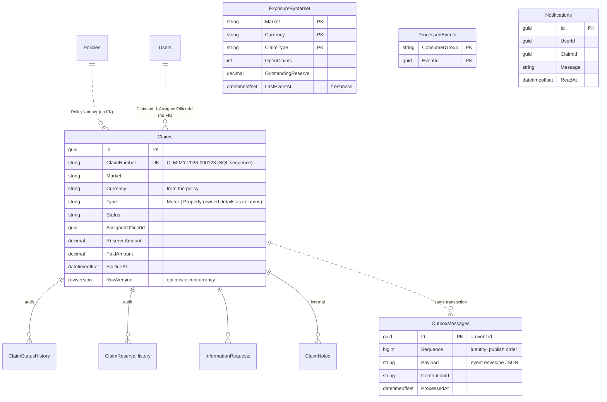

# Architecture

One deployable .NET 10 API (a modular monolith) on SQL Server, with Kafka between the claims write side and everything that reacts to it.
Why it is shaped this way: [decisions.md](decisions.md).

## 1. Components



**Project dependencies (enforced by project references):**

```
Presentation → Service → Repository → Domain
Presentation → Messaging → Repository → Domain
```

- **Domain** has no package references.
- **Service** knows nothing about EF Core or Kafka.
- **Messaging** knows nothing about ASP.NET Core: it pushes through `IRealtimePush`, which the host implements with SignalR.

## 2. What happens when a claim changes

The example is a claimant submitting an FNOL. Every officer action follows the same path.

```mermaid
sequenceDiagram
    autonumber
    actor C as Claimant
    participant API as API (ClaimService)
    participant DB as SQL Server
    participant PUB as Outbox publisher
    participant K as Kafka
    participant EXP as Exposure projector
    participant NOT as Realtime notifier
    actor M as Manager (browser)

    C->>API: POST /api/claims (JWT, X-Correlation-Id)
    API->>API: Claim.Submit(...) validates policy, dates, details;<br/>raises ClaimSubmitted
    API->>DB: one transaction: INSERT claim + history + OutboxMessages row
    API-->>C: 201 Created, CLM-MY-2026-000014
    Note over C,API: The user waits only for this. Kafka can be down.

    loop every second
        PUB->>DB: unpublished rows, ORDER BY Sequence
        PUB->>K: produce (key = claimId, headers: event-type, event-id, correlation-id), Acks=All
        PUB->>DB: mark published
    end

    par own consumer group each
        K->>EXP: ClaimSubmitted
        EXP->>DB: one transaction: skip if (group, eventId) seen;<br/>UPDATE exposure SET open = open + 1, outstanding = outstanding + reserve;<br/>INSERT ProcessedEvents
        EXP-->>M: SignalR ExposureUpdated (managers)
    and
        K->>NOT: ClaimSubmitted
        NOT->>DB: one transaction: notifications + ProcessedEvents
        NOT-->>C: SignalR ClaimUpdated (owner + market staff)
    end
    M->>API: GET /api/reports/exposure (push is a hint; REST is the truth)
```

**Guarantees, and where they come from:**

| Guarantee | Mechanism |
|---|---|
| A claim change never loses its event, and no event is published for a rolled-back change | Outbox row written in the same `SaveChanges` transaction (`DomainEventsToOutboxInterceptor`) |
| A claim's events stay in order | Outbox `Sequence` (identity) order; the publisher stops at the first failure; Kafka key = `claimId`, so one partition per claim |
| No duplicates from producer retries | `EnableIdempotence = true`, `Acks = All` |
| Each event is applied exactly once per consumer | Offset committed only after processing; `ProcessedEvents (ConsumerGroup, EventId)` primary key in the same transaction as the side effect |
| No lost updates with several projector instances | Atomic `UPDATE … SET x = x + delta`, never read-modify-write |
| Two officers acting on the same claim | `RowVersion` optimistic concurrency → 409 |
| One request can be traced end to end | Correlation id → log scope → outbox row → Kafka header → consumer log scope |

**Failure behaviour:**

| What fails | What happens |
|---|---|
| Kafka down | Claims and actions still succeed; events wait in the outbox and drain when Kafka returns (tested: ~9 s after restart) |
| Database down while consuming | The handler retries with backoff and the partition waits; nothing is skipped |
| Message isn't a valid envelope | Logged and skipped (retrying can't fix it); a dead-letter topic is the next step |
| SignalR push fails | Logged; the notification is already stored and the client refetches over REST |

## 3. Claim lifecycle

The state machine is a single transition table (`Domain/Rules/ClaimTransitions.cs`). Any other combination is rejected with **409**.



**Who may act:**
- Only the **owning claimant** may answer an information request.
- Only **staff in the claim's market** may see the claim or pick it up.
- After pick-up, only the **assigned officer** may change the reserve, request information, approve, settle or reject.
- Any staff member in the market may add a note.

These rules live in the aggregate, so no endpoint can bypass them.

**Money rules:**
- At FNOL, the reserve is the claimant's estimate, or a per-market default for the claim type.
- The reserve can never be negative. A reason is required for every change, and each change is kept in the audit history.
- Approving sets the reserve to the settlement amount.
- Settling or rejecting releases the outstanding reserve to 0.

**SLA:**
- The decision is due 10 days after reporting.
- A claim is overdue when that date has passed **without a decision**.
- Priority is set once, at FNOL: High when the claimant's estimate is above the market's threshold. It is not recalculated when the reserve changes; that would be a small follow-up.

## 4. Data model



- **Write model:** `Claims` and its children, changed only through the aggregate.
- **Read models:** `ExposureByMarket` and `Notifications`, written only by Kafka consumers.
- **Policies and users** belong to other systems in real life, so claims refer to them by id with no foreign keys.

## 5. The event contract (`claims.events.v1`)

```json
{
  "eventId": "01a1fc75-…", "eventType": "ClaimApproved", "eventVersion": 1,
  "occurredAt": "2026-11-19T04:55:27Z",
  "claimId": "01a1fc75-…", "claimNumber": "CLM-MY-2026-000005", "claimantId": "01a1fc75-…",
  "market": "MY", "currency": "MYR", "claimType": "Motor",
  "data": { "settlementAmount": 5800, "oldReserve": 6200, "newReserve": 5800 }
}
```

- **Event types:** ClaimSubmitted, ClaimPickedUp, ReserveAdjusted, InformationRequested, InformationProvided, ClaimApproved, ClaimSettled, ClaimRejected.
- **Headers:** `event-type`, `event-id` and `correlation-id`.
- **Versioning:** adding fields keeps v1, and consumers ignore fields they don't know. A breaking change means a new topic version.
- **Self-contained:** the envelope carries the claim context every consumer needs, so consumers never call back into the API.
- **Tested from both sides:** a unit test builds events through the producer and parses them through the consumer's own contract, with no broker.

## 6. Security

- **JWT authentication.** A development login stands in for a real identity provider. The rest of the API depends only on the token's claims (`sub`, `role`, `market`).
- **Every endpoint requires sign-in by default.** Only dev-login, OpenAPI, Scalar and `/health` are anonymous.
- **Three layers of authorization:**
  - the role, checked at the controller
  - ownership or market, checked in the service
  - the assigned officer, checked in the aggregate
- **Other people's data returns 404, never 403**, so claim, policy and notification ids can't be probed.
- **Claimants never see internal fields:** reserve, priority, notes and reserve history.
- **SignalR groups are assigned by the server from the token.** The client can't choose what it listens to. The token in the query string is accepted only on the hub path and is never logged.
